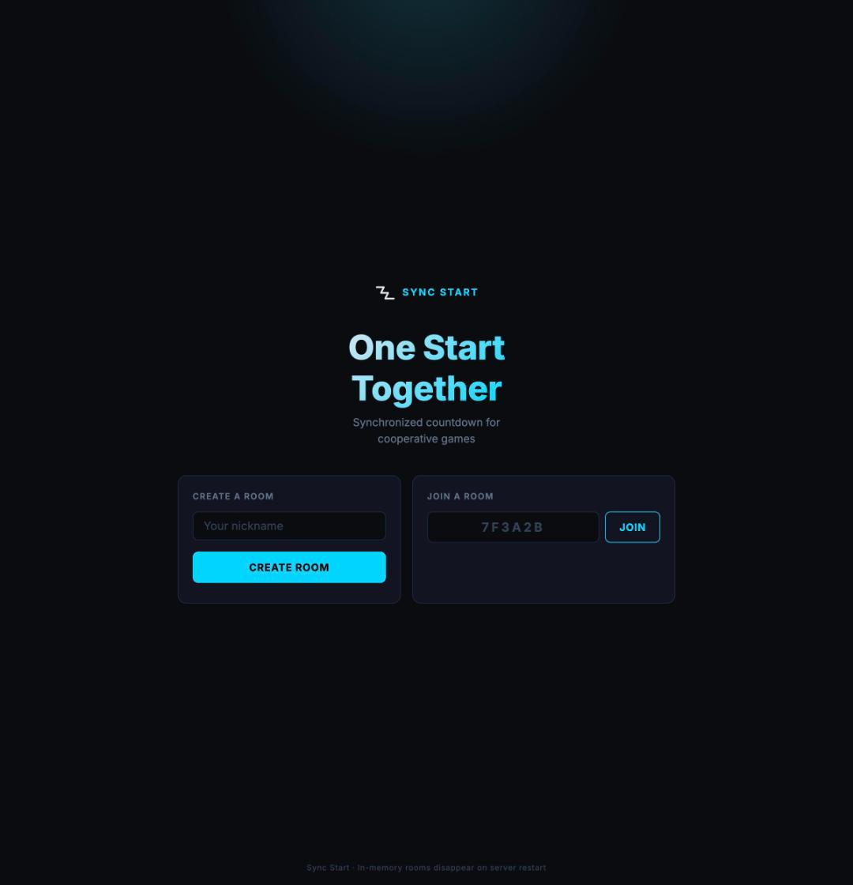
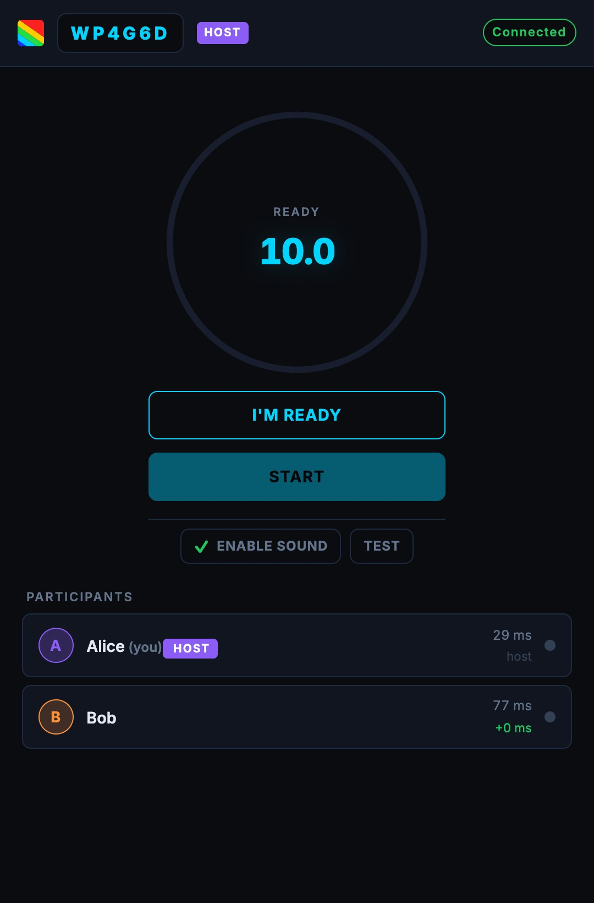
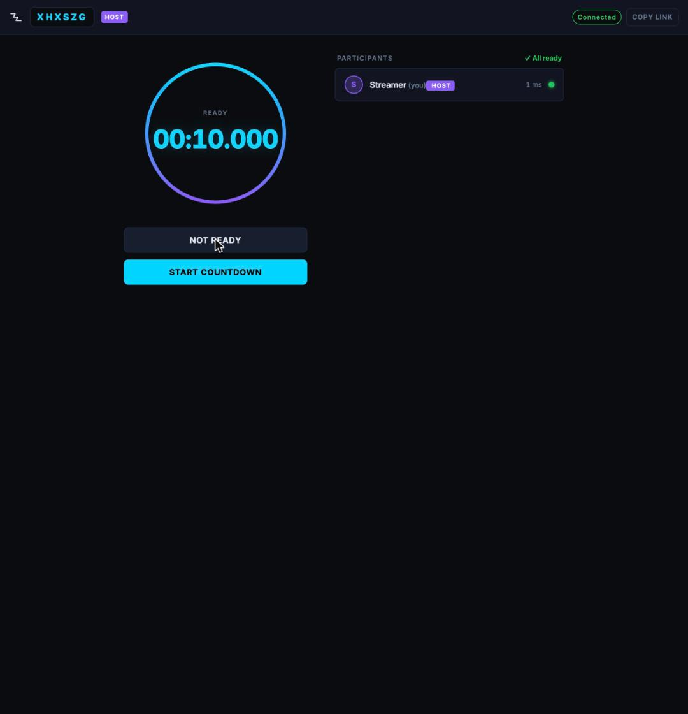
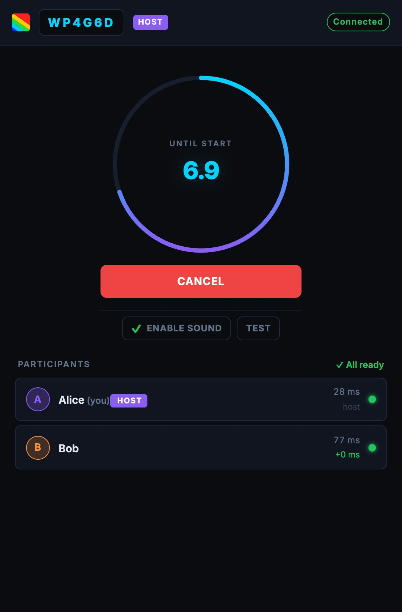

# Sync Start

**Synchronized multiplayer countdown for cooperative games.**

One host starts the countdown; all players see the same timer and click their in-game start button the moment **GO!** appears.

---

## Screenshots

| Landing | Lobby (host) | All ready |
|---------|-------------|-----------|
|  |  |  |

| Countdown | GO! |
|-----------|-----|
|  |  |

---

## How it works

1. **Host** enters a nickname and clicks **Create Room** → gets a shareable 6-character code and link (`/room/ABC123`).
2. **Players** open the link or type the code, enter a nickname, and join. Sharing the link in Telegram shows a preview card.
3. Everyone clicks **I'm Ready**. The host's **Start** button lights up when all connected players are ready.
4. The host presses **Start**. The timer (shown as `10.0` in the lobby) counts down for everyone simultaneously, with beeps at 3, 2 and 1 seconds.
5. At zero, a full-screen green **GO!** signal appears for 5 seconds.
6. The host can start another round without recreating the room.

> **Note:** This synchronises the *signal time*, not physical inputs. Human reaction time, network jitter, display latency, and game scheduling all contribute additional variance.

### Sound

Browsers only allow audio after a user gesture. Sound is enabled automatically on your first click, tap or key press in the room. The **Enable Sound** button is red until audio is active, then turns plain with a green check. Use **Test** to check your volume. Beeps are scheduled on the audio clock, so they stay in sync even if the tab is in the background.

### Clock check

Each participant row shows the **RTT** and the **clock offset relative to the host**. A warning appears if your clock differs from the host's by more than 1 second.

### Reconnecting and missing rooms

If you refresh or lose connection, the page reconnects automatically and restores your place (a secret token is kept in the tab's `sessionStorage`). If the room no longer exists, you are returned to the first screen with an error.

### Supported browsers

Current Chrome, Firefox, Safari, Edge and Yandex Browser. If a required feature (WebSocket, Performance API, Fetch) is missing, a lock screen explains what to update.

---

## Running locally

**Requirements:** Go 1.23+ (Node.js is only needed for JS tests and linters)

```bash
git clone https://github.com/archer-developer/arcsync
cd arcsync
go run ./cmd/server          # listens on :8080 by default
```

Open <http://localhost:8080> in your browser.

**Custom port:**

```bash
go run ./cmd/server -addr :9090
```

---

## Configuration

All configuration is via command-line flags:

| Flag    | Default | Description           |
|---------|---------|-----------------------|
| `-addr` | `:8080` | HTTP listen address   |
| `-log-dir` | `logs/` next to the binary | Directory for usage event logs |

Room state is **in-memory** — rooms disappear on server restart. This is by design for the MVP.

Limits: up to 32 participants per room and 10,000 rooms per server. Rooms with nobody connected are removed after 10 minutes; participants who stay disconnected for 30 seconds are dropped.

---

## Usage logs

The server appends structured events (one JSON object per line) to `logs/events-YYYY-MM-DD.log` next to the binary (one file per UTC day):

| `msg`              | Fields                                                                 |
|--------------------|------------------------------------------------------------------------|
| `server_started`   | `addr`                                                                 |
| `room_created`     | `room_id`                                                              |
| `participant_joined` | `room_id`, `nickname`, `is_host`, `reconnect`, `connected`           |
| `latency_measured` | `nickname`, `rtt_ms`, `clock_offset_ms` (first measurement per connection) |
| `countdown_started`| `room_id`, `round_id`, `lead_ms`, `connected`, `participants[]` with each player's `rtt_ms` / `clock_offset_ms` |
| `round_go`         | `room_id`, `round_id`, `connected`                                     |
| `participant_left` | `nickname`, last `rtt_ms` / `clock_offset_ms`, `session_ms`            |
| `room_removed`     | `room_id` (empty room cleaned up)                                      |

Examples (with [jq](https://jqlang.github.io/jq/)):

```bash
# rooms created per day
cat logs/events-*.log | jq -r 'select(.msg=="room_created") | .time[:10]' | sort | uniq -c

# RTT of everyone who joined
cat logs/events-*.log | jq -r 'select(.msg=="latency_measured") | [.time, .nickname, .rtt_ms] | @tsv'

# players per started round
cat logs/events-*.log | jq -r 'select(.msg=="countdown_started") | [.time, .room_id, .connected] | @tsv'
```

Client IP addresses are not logged. Files are not deleted automatically — rotate or prune old days yourself.

---

## Building for production

```bash
# Linux binary (for server deployment)
GOOS=linux GOARCH=amd64 go build -ldflags="-s -w" -o arcsync ./cmd/server

# Or with Docker
docker build -t arcsync .
docker run -p 8080:8080 arcsync
```

---

## Development

### Run tests

```bash
# Go tests (room state machine, registry, WebSocket hub)
go test -race ./cmd/... ./internal/...

# JavaScript tests
npm test

# All linters
npm run lint                                   # ESLint + Stylelint
golangci-lint run ./cmd/... ./internal/... ./web/...   # Go linters
```

### Project structure

```
cmd/server/main.go          HTTP server, REST endpoints, WebSocket upgrade, room cleanup
internal/
  room/                     Room state machine, participant management, registry
  realtime/                 WebSocket hub, client pump goroutines, message types
  syncclock/                Injectable clock interface (real + test-friendly)
  eventlog/                 Daily-rotating JSON usage log
web/
  index.html                Single HTML page (SPA — all screens in one file), meta tags
  css/styles.css            Dark high-tech styling, CSS variables, responsive
  img/                      Open Graph preview image, apple-touch-icon
  js/
    timer.js                Clock sync, requestAnimationFrame countdown, formatTime
    audio.js                Web Audio countdown beeps scheduled on the audio clock
    socket.js               WebSocket client, auto-reconnect with exponential backoff
    app.js                  Room state, routing, DOM updates
    timer.test.js           Jest tests for timer utilities
docs/                       ADRs, screenshots, source of the preview image
```

---

## HTTP API

| Method & path            | Purpose                                                         |
|--------------------------|-----------------------------------------------------------------|
| `POST /api/rooms`        | Create a room → `{room_id, host_token}` (`503` if server is full) |
| `GET /api/rooms/{id}`    | `204` if the room exists, `404` otherwise                       |
| `GET /ws?room={id}`      | WebSocket endpoint (same-origin only)                           |
| `GET /room/{id}`         | The single-page app                                             |

---

## WebSocket protocol summary

**Client → Server**

| Type                | Purpose                                    |
|---------------------|--------------------------------------------|
| `join_room`         | Join or reconnect to a room                |
| `set_ready`         | Toggle ready state                         |
| `start_countdown`   | Host: start at an absolute time (`start_at`, Unix ms) |
| `cancel_countdown`  | Host: cancel an active countdown           |
| `time_sync`         | Clock sync probe with RTT and client clock (every 2 s) |

**Server → Client**

| Type                  | Purpose                                        |
|-----------------------|------------------------------------------------|
| `room_state`          | Full snapshot plus your `you` ID and secret `reconnect_token` |
| `participant_joined`  | New participant connected                      |
| `participant_updated` | Readiness, RTT or clock offset changed         |
| `participant_left`    | Participant disconnected                       |
| `countdown_started`   | Authoritative `startAt` and `goUntil` (Unix ms)|
| `countdown_cancelled` | Countdown cancelled by host or host disconnect |
| `go`                  | Countdown reached zero                         |
| `countdown_reset`     | GO window expired, back to lobby               |
| `time_sync_result`    | Echo of sync probe with server timestamps      |
| `error`               | Validation or state error                      |

All timestamps are **Unix milliseconds**. When the host presses **Start**, the client sends its server-synchronised "now" + 10 s as `start_at`; the server accepts it only if it is 3 s to 24 h in the future, then broadcasts it. Clients compute remaining time as `startAt - estimatedServerNow` on every animation frame.

---

## Latency display

The RTT shown next to each participant is the **WebSocket round-trip time** — the time from when the client sent a sync probe to when it received the response. It is **not** a measure of human reaction time or game input latency. The clock offset next to it is the estimated difference between that participant's system clock and the host's.

---

## Known limitations

- Rooms are in-memory and disappear on server restart.
- No horizontal scaling — all clients in a room must connect to the same process.
- No SSL termination built in — use a reverse proxy (Nginx, Caddy) for HTTPS in production. The proxy must pass WebSocket upgrade headers (`Upgrade`, `Connection`) and allow long-lived connections (e.g. `proxy_read_timeout 86400`).
- Browsers throttle background tabs, so the on-screen timer may lag there; the audio cues stay on time.
- Clock synchronisation is based on RTT halving, which assumes symmetric network paths. Highly asymmetric paths will introduce a small offset error.
